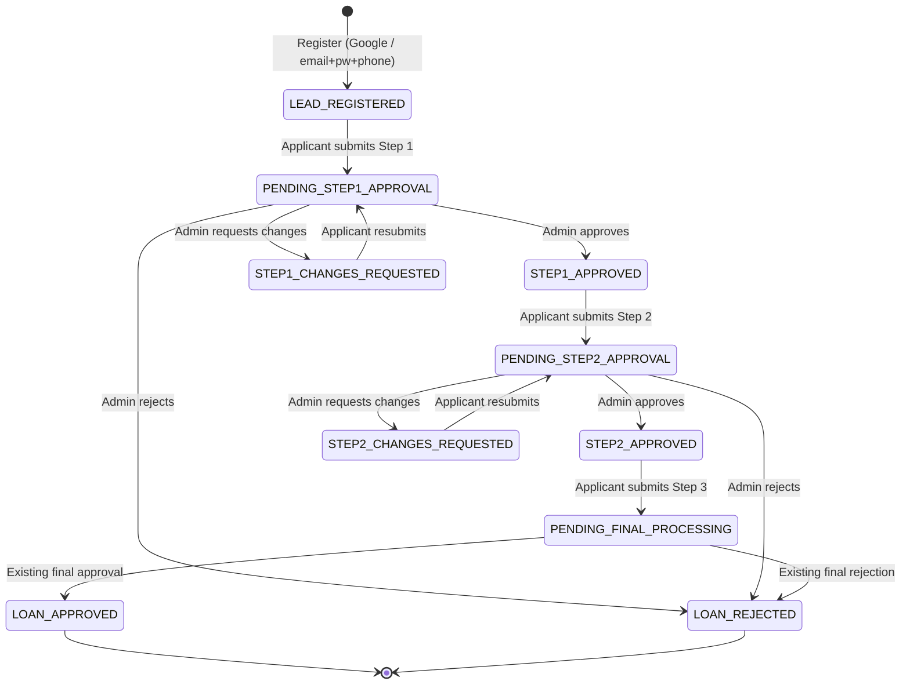

# Implementation Plan — 3-Step Approval Workflow for QuickLoan

> **Status: PLAN ONLY. No files have been changed.** Section 9 lists decisions I need from you. Section 10 is the proposed build order.

---

## 1. What exists today (review findings)

**Stack:** Express 5 + SQLite (`backend/server.js`, `database.js`) and React 19 + Vite + Tailwind (`frontend/`). Hebrew/English with RTL. Conventions are in [CLAUDE.md](file:///c:/Dev/digital-loan-app-v2/CLAUDE.md).

### 1.1 Two applicant flows exist in [App.tsx](file:///c:/Dev/digital-loan-app-v2/frontend/src/App.tsx)

| Flow | Components | State |
|---|---|---|
| **"Intermediary" flow** (default) | [Step1LeadGeneration](file:///c:/Dev/digital-loan-app-v2/frontend/src/components/Step1LeadGeneration.tsx) → [Step2ApplicationCompletion](file:///c:/Dev/digital-loan-app-v2/frontend/src/components/Step2ApplicationCompletion.tsx) | **Front-end only, mocked.** |
| **"Classic" 9-step wizard** (behind a "classic wizard" link) | `Step2Auth` → `Step3…Step11` | Real: users, applications, uploads, notifications, SSE, Back Office. |

**Critical finding about the intermediary flow (the one this project redesigns):**
- It never calls the backend. The lead lives in React state (`leadData`), so it is lost on refresh.
- The email and password typed in Step 1 are **never used to create an account**.
- Uploaded files keep only `{name,size,type}`. The file itself is never uploaded.
- "Approval" is a **mock toggle button shown to the applicant** (`simulate-approved-btn`). The applicant can approve themselves.
- Step 2 `onCompleted` only does `console.log`.
- Step 2 currently holds bank details, the bank document, sponsors (Israeli/foreign split) and both T&C checkboxes. Step 3 does not exist.
- Nothing reaches the Back Office, no SMS or email is sent, and no audit trail is written.

So most of this project is **building the real backend workflow** behind a UI that is only partly there.

### 1.2 Existing building blocks I will reuse

| Area | Existing asset | Reuse |
|---|---|---|
| Auth | Phone OTP, password login, forgot/reset, mock Google (`/users/google-demo`, demo mode only), JWT, `canAccessUser`, `requireStaff(roles)` | Reuse. Add real Google verification and real staff login (see 5.5). |
| Uploads | `POST /api/upload` (multer, MIME allow-list, magic-byte check, owner in `uploaded_files`), `GET /api/uploads/:file` with ownership check; staff pass via `isStaff` | Reuse for all step documents. Allowed types are already images + PDF. |
| Loan math | `calculateLoanRepayment()` in [appConfig.ts](file:///c:/Dev/digital-loan-app-v2/frontend/src/config/appConfig.ts): 8.5% APR annuity, tiered fixed service fee, 3/6/9 months | **Frontend only today.** Port to backend with a parity test (see 5.4). |
| Notifications | `createNotification` (in-app row + SMS), `notifyStatusChange`, SSE `broadcastAppEvent`, [messages.js](file:///c:/Dev/digital-loan-app-v2/backend/services/messages.js) (en/he), `smsService` (Twilio or mock), `emailService` (SMTP or mock), `NotificationDrawer` | Reuse. Add an event dispatcher that sends in-app + SMS + email per the matrix. |
| Back Office | [BackOffice.tsx](file:///c:/Dev/digital-loan-app-v2/frontend/src/components/BackOffice.tsx) (list, filters, detail, PDF/JSON export, audit tab, analytics, credit rules), role picker | Extend, don't replace. |
| Scoring | `creditEngine.js`, `eligibilityScoring.js` (use `guarantors` count) | Map sponsors → `guarantors` so scoring and PDF keep working. |
| Final decision | Canonical statuses `Received → Under Review → Additional Document Required → Approved / Rejected → Forwarded to Funding Entity`, staff-driven via `PUT /applications/:id` | This **is** the "existing final approval and loan-granting procedure". No agreement/contract generator exists in the code. |

### 1.3 Existing weaknesses that affect this project

1. **No real staff authentication.** Staff tokens come from `/api/auth/staff-token`, a demo-only role picker. With `DEMO_MODE=false` nobody can reach the Back Office. "Only authorized administrators can approve" cannot be met in production without real staff accounts.
2. **Demo identity fallback.** With no token, `authenticate` assigns `demo_user` in demo mode. Approval endpoints must still be staff-only, and tests must also run against `DEMO_MODE=false`.
3. **`PUT /api/applications/:id` is too permissive for a gated workflow.** Any staff role can set any status; a borrower can write any draft field. A gated flow must not be reachable through it.
4. **Back Office mixes local and server data.** `BackOffice.tsx` seeds from `localStorage` (`storageService.getAllApplications`, `updateApplicationStatus`) and syncs to the server afterwards. For the new flow the server must be the only source of truth.
5. **Back Office and analytics list only `isSubmitted = 1`.** A "Lead / Registered" record would be invisible.
6. **Rounding quirk (existing):** `totalInterestNis = monthlyPayment×n − principal − fee`, and `monthlyServiceFeeNis` is rounded. For example, 5000 NIS over 9 months gives a 350 fee, but 39×9 = 351, so interest is overstated by 1. I will **not** change the formula ("use existing rules"). I will flag it and show figures that reconcile (see 5.4).
7. The 3/6/9/12 months mention in older docs differs from the code (3/6/9). I follow the code.

---

## 2. Target workflow

### 2.1 Status model

A new **`flowStatus`** field is the single user-facing and Back Office status. The existing canonical `status` column stays and keeps driving the final-processing stage.

| `flowStatus` (code) | Label (en) | Group* | Applicant can act on | Entered by |
|---|---|---|---|---|
| `LEAD_REGISTERED` | Lead / Registered | In progress | Step 1 | Registration (Google or manual) |
| `PENDING_STEP1_APPROVAL` | Pending Step 1 Approval | **Pending** | nothing | Step 1 submit |
| `STEP1_CHANGES_REQUESTED` *(added)* | Step 1 – Changes Requested | In progress | Step 1 | Admin |
| `STEP1_APPROVED` | Step 1 Approved – Step 2 Pending | **Approved (stage)** | Step 2 | Admin approve |
| `PENDING_STEP2_APPROVAL` | Pending Step 2 Approval | **Pending** | nothing | Step 2 submit |
| `STEP2_CHANGES_REQUESTED` *(added)* | Step 2 – Changes Requested | In progress | Step 2 | Admin |
| `STEP2_APPROVED` | Step 2 Approved – Step 3 Pending | **Approved (stage)** | Step 3 | Admin approve |
| `PENDING_FINAL_PROCESSING` | Final Application Submitted (Pending Final Processing) | **Completed** | nothing | Step 3 submit |
| `LOAN_APPROVED` | Loan Approved | **Approved (final)** | nothing | Existing final approval |
| `LOAN_REJECTED` | Loan Rejected | **Rejected** | nothing | Admin at Step 1/2, or existing final rejection |

\*The Back Office gets group chips for Pending / Approved at stage / Completed / Approved final / Rejected. The spec uses "Final Application Submitted" (§4.4) and "Pending Final Processing" (§5.2) for the same state; I will show both in one label.

**Link to the existing final stage:** while `flowStatus = PENDING_FINAL_PROCESSING`, the canonical `status` runs through the **unchanged** staff procedure (`Received → Under Review → Additional Document Required`). Moving canonical `status` to `Approved` or `Forwarded to Funding Entity` sets `LOAN_APPROVED`. Moving it to `Rejected` sets `LOAN_REJECTED`. Step 3 never sets Approved, so submitting Step 3 can never grant the loan.

**Rules**
- Transitions are defined once in `backend/services/workflow.js` as a table `{from, action, actorRoles, to, guards}`. Anything not in the table returns HTTP 409.
- A rejection stores `rejectedAtStep` (1, 2 or final) and a reason. A rejected application never advances. The applicant sees the reason and any re-application rule.
- Everything is stored on **one** application row per applicant journey.
- Legacy rows (`flowVersion` NULL) keep the old statuses and are not migrated.

---

## 3. Mapping existing functionality → new workflow

| Requirement | Today | Change |
|---|---|---|
| Step 1 registration (Google or manual) | Mock UI; real auth only in the classic wizard | Real registration at the start of Step 1, creating `users` and an application with `LEAD_REGISTERED` |
| Location + disclaimer (first time) | Present in `Step1LeadGeneration` | **Keep as is.** Add server-side consent record (timestamp, version) |
| Form order | Credentials → Personal → Docs → Employment → Loan | Reorder: Personal → Credentials → Docs (image/PDF) → Employment → Loan Amount. Same fields and validation |
| Mandatory guarantor notice | Absent | Add the exact English text above the submit button, plus Hebrew |
| Step 1 submit | Local state | Server submit → `PENDING_STEP1_APPROVAL`, Back Office record, SMS + email + in-app, existing confirmation screen |
| Step 1 approval | Mock toggle in applicant UI | **Remove the toggle.** Staff-only endpoint; unlocks Step 2; SMS + in-app (+ email) |
| Step 2: remove bank + bank doc | Present | Move to Step 3 |
| Step 2: sponsors | Israeli/foreign type, name, ID or passport+visa docs | One shape: `{ idOrPassportNumber, fullName }` (min 1, max 3 as today). Keep the existing progress bar |
| Step 2: amount, duration, estimate | Present | Keep UI and `calculateLoanRepayment` unchanged. Prefill from Step 1 |
| Step 2: terms checkboxes | Present | **Move to Step 3** (§4.3) |
| Step 3 | Does not exist | New: breakdown, bank details, bank document, two terms, final submit |
| Back Office | Classic statuses; local+server mix | New lead/step queue, per-stage Approve / Reject / Request changes, full record view, terms acceptance, audit trail |

---

## 4. Data model changes

SQLite, added the repo's way (`ALTER TABLE … ADD COLUMN` / `CREATE TABLE IF NOT EXISTS` in `database.js`). **Nothing is dropped; existing rows stay valid.**

**`applications` – new columns:** `flowVersion` (INTEGER, 2 = new flow), `flowStatus`, `unlockedStep` (1–3), `rejectedAtStep`, `rejectionReason`, `step1Data`, `step2Data`, `step3Data` (JSON; each step is kept separately so earlier data is preserved), `step1SubmittedAt`, `step2SubmittedAt`, `step3SubmittedAt`, `flowCompletedAt`, `loanBreakdown` (JSON snapshot of the calculated figures and the config/rate/fee tier used), `leadSource` (`google` | `manual`).

**New tables**

| Table | Purpose |
|---|---|
| `application_step_reviews` | One row per decision: `applicationId, step, decision (approved/rejected/changes_requested), note, reviewerId, reviewerRole, revision, decidedAt` |
| `application_step_submissions` | Immutable snapshot of each submission and resubmission (`step, revision, data, submittedAt`). Preserves history across corrections |
| `audit_log` (append-only) | `id, applicationId, actorType, actorId, actorRole, action, fromStatus, toStatus, metadata, ip, userAgent, createdAt`. Records registration, submissions, approvals, rejections, status changes, terms acceptance, document uploads and notification dispatch |
| `terms_versions` | `type (general / service_fee), version, textEn, textHe, sha256, effectiveFrom`. Seeded v1.0 from the current Step 2 terms text |
| `terms_acceptances` | `applicationId, userId, termsType, version, textSha256, acceptedAt, ip, userAgent, language` |
| `staff_users` | Real Back Office accounts (see 5.5) |
| `notification_deliveries` | Per event and channel (`in_app`/`sms`/`email`): `status`, `providerId`, `error`, `attempts`. Gives visibility of failed sends |

**Documents:** stay in the existing `applications.documents` JSON plus `uploaded_files`. Add `step` (1/3) and `documentTypeCode` values `PASSPORT`, `WORK_VISA`, `PAY_SLIP`, `BANK_ACCOUNT_DOCUMENT`. The server rejects a submit whose referenced files are missing or owned by another user.

**Sponsors:** stored in `step2Data.sponsors` and mirrored into `guarantors[]` (`fullName`, `passportOrIdNumber`) so eligibility scoring, credit pre-screen and the PDF keep working.

---

## 5. Backend plan

### 5.1 New endpoints (all registered after the `authenticate` line unless noted)

| Method & path | Who | Purpose |
|---|---|---|
| `POST /api/flow/register` *(public, rate-limited)* | applicant | Manual signup: email + password + phone. Phone verified by the existing OTP. Creates user + `LEAD_REGISTERED` application |
| `POST /api/flow/google` *(public)* | applicant | Verify a Google ID token server-side (`GOOGLE_CLIENT_ID`). Demo mode keeps the mock |
| `GET /api/flow/application` | applicant | The caller's application, `unlockedStep`, `flowStatus`, staff messages, per-step data |
| `PUT /api/flow/application/steps/:n/draft` | applicant | Save a draft of step *n*. Only if `n ≤ unlockedStep` and the step is editable |
| `POST /api/flow/application/steps/:n/submit` | applicant | Validate fully server-side, snapshot, transition, notify |
| `POST /api/flow/application/steps/3/accept-terms` *(or part of submit)* | applicant | Record terms acceptance with version and hash |
| `GET /api/flow/applications` | staff | Queue with filters (`flowStatus`, group, step, search) |
| `GET /api/flow/applications/:id` | staff | Full centralized record: all steps, documents, breakdown, acceptances, reviews, audit |
| `POST /api/flow/applications/:id/steps/:n/decision` | authorized staff | `{decision: approve\|reject\|request_changes, note}` |
| `POST /api/flow/applications/:id/message` | staff | Free-text message to the applicant (in-app + SMS) for corrections |
| `GET /api/flow/applications/:id/audit` | staff | Audit trail |
| `GET /api/flow/terms/current` | applicant | Current terms texts and versions |

### 5.2 Server-side enforcement (the "cannot bypass" guarantees)

- **Sequence and gating:** the submit handler checks `n === unlockedStep` and the status is submittable (`LEAD_REGISTERED`, `STEP1_APPROVED`, `STEP2_APPROVED`, or the matching `*_CHANGES_REQUESTED`). Step 2 before Step 1 approval returns 403/409. Resubmitting a pending step returns 409.
- **Ownership:** the application is resolved from the token. The client never supplies `userId`.
- **Immutability:** after a step is submitted, its data is read-only for the applicant until changes are requested.
- **Legacy route lock:** for `flowVersion = 2`, `PUT /api/applications/:id` ignores or rejects `status`, `flowStatus`, step data and `isSubmitted`, and tells the caller to use `/api/flow/*`. Staff canonical-status changes for the final stage go through a thin wrapper that applies the mapping in section 2.1 and writes the audit row.
- **Full validation on the server**, not only in the UI: all Step 1 fields; the three documents; ≥ 1 sponsor with ID/passport and name; Step 3 bank fields; bank document present; both terms accepted at the current versions.
- **Step 3 submit is atomic:** save data, record acceptances, snapshot the breakdown, set `PENDING_FINAL_PROCESSING`, mark `flowCompletedAt`, write audit, send notifications (one DB transaction for the data; notifications after commit).
- **Approvals** are recorded in `application_step_reviews` + `audit_log` with the reviewer id and role, and only via the decision endpoint.

### 5.3 Notifications

One `notifyWorkflowEvent(event, application)` dispatcher, called after commit. Text lives in `messages.js` (en + he), per the repo convention. Each message states **what happened, the current status, whether the applicant must act, and what is available next**.

| Event | In-app | SMS | Email |
|---|---|---|---|
| `STEP1_SUBMITTED` | ✔ | ✔ | ✔ |
| `STEP1_APPROVED` | ✔ | ✔ | optional → on by default, switch in `app_config` |
| `STEP2_SUBMITTED` | ✔ | ✔ | ✔ |
| `STEP2_APPROVED` | ✔ | ✔ | optional (same switch) |
| `STEP3_SUBMITTED` | ✔ | ✔ | ✔ |
| `LOAN_APPROVED` / `LOAN_REJECTED` | ✔ | ✔ | ✔ |
| Changes requested / step rejected *(added; needed for §5.3 corrections)* | ✔ | ✔ | ✔ |

- Each channel is logged in `notification_deliveries`. A failing SMS or email never rolls back the workflow. It is recorded as `failed` and shown to staff, with a retry.
- Hebrew SMS is UCS-2 (70 chars), so Hebrew texts stay short and link to the in-app message for detail.
- Google users without email on file get SMS + in-app only; users without a phone number (not possible for manual signup) get email + in-app.
- The existing SSE channel pushes status changes so the applicant's screen updates live.

### 5.4 Loan calculation (financial accuracy)

- Port `calculateLoanRepayment` and `getServiceFeeForAmount` unchanged to `backend/services/loanCalculator.js`.
- The server **recomputes** at Step 2 and Step 3 submit and ignores client-sent figures. The result is stored as a snapshot (`loanBreakdown`), so later config changes never alter a submitted application.
- **Parity test:** a shared fixture file of amounts × periods. The backend test checks the Node implementation. A Vitest test checks `appConfig.ts` against the same fixture. Drift fails CI.
- **Step 3 display:** the app already computes `baseMonthlyRepaymentNis` (loan-only) and `monthlyServiceFeeNis` separately. I will show:

| Line | Source |
|---|---|
| Requested Loan Amount | principal |
| Total Interest | `totalInterestNis` |
| Total Service Fee | `serviceFeeNis` |
| **Total to be repaid incl. interest** (loan only, excl. fee) | `baseMonthlyRepaymentNis × n` |
| **Monthly repayment incl. interest** (loan only) | `baseMonthlyRepaymentNis` |
| **Monthly service fee** | `monthlyServiceFeeNis` |
| Total payable monthly / overall *(extra summary row)* | `monthlyPaymentNis` / `totalRepaymentNis` |

  Loan and fee are separate blocks with a one-line explanation of the difference. The rounding quirk in 1.3(6) stays as is (flagged, not "fixed").

### 5.5 Authentication and permissions

- **Staff accounts (new, needed):** `staff_users` (bcrypt, role, active flag), `POST /api/auth/staff-login`, and a seed script (`npm run seed:staff`) reading initial admin credentials from env. The role picker stays only under `DEMO_MODE`.
- **Permission matrix** (constant, easy to change):

| Action | customer_service | credit_reviewer | system_admin | funding_entity |
|---|:-:|:-:|:-:|:-:|
| View applications | ✔ | ✔ | ✔ | ✔ |
| Request changes / message applicant | ✔ | ✔ | ✔ | – |
| **Approve / reject Step 1 & 2** | – | ✔ | ✔ | – |
| Final decision (existing rules) | – | ✔ | ✔ | – |
| Funding handoff (existing) | – | – | ✔ | ✔ |

- **Google:** real flow uses Google Identity Services + server verification (`google-auth-library`). It needs a `GOOGLE_CLIENT_ID` from you. Until set, only the demo mock works and the real button is hidden.
- **Manual registration:** password ≥ 8 chars (as today), email uniqueness, rate-limited OTP, same-phone duplicate handling via the existing lookup.

---

## 6. Frontend plan

### 6.1 Applicant app
- **New orchestrator `FlowApp`** replaces the intermediary container. It always loads state from `GET /api/flow/application` and renders the allowed step. Locked steps show a lock and an explanation; there are no client-only status toggles.
- **Entry:** Welcome → (first time) Location → Disclaimer → Step 1. Returning users get "Already registered? Sign in", reusing `Step2Auth` (password / OTP / Google), then resume at their current step.
- **Step 1** (rework `Step1LeadGeneration`): sections in the required order, real uploads through `apiService.uploadFile` (image/PDF, progress, remove/replace), the guarantor notice directly above Submit, and Google sign-up at the top. The existing confirmation screen remains, minus the simulator, plus "awaiting verification".
- **Step 2** (rework `Step2ApplicationCompletion`): sponsors (ID/passport + full name) and loan amount / months / estimate. Bank block, bank document and T&C removed.
- **Step 3** (new `Step3FinalSubmission`): breakdown card; bank details (reusing `ISRAELI_BANKS`); mandatory bank document upload; the two terms with a "view" modal showing versioned text; submit disabled until everything is valid.
- **Status hub** (new, replaces the intermediary tab bar): 3-step stepper, current status badge, latest message from staff, the next action, and notification history. Shown after every submit and on every login.
- **Classic 9-step wizard:** it lets an applicant skip approvals. **Proposal:** hide its entry link behind `VITE_ENABLE_CLASSIC_FLOW` (default off) and keep the code and tests. Classic applications stay readable in the Back Office.
- Notification drawer and bell reuse the existing components with new types and an unread badge.

### 6.2 Back Office
- **Queue tab:** a quick-filter bar by group (Pending review · Approved at stage · Completed · Loan approved · Rejected) and by status. Counts per group. Pending items sorted oldest first with an age badge. Search by name, phone, email, request number, passport.
- **Application detail:** a single view with tabs for Step 1, Step 2 and Step 3, plus Documents, Financials, Terms & consent, Timeline/Audit. Documents are viewable and downloadable through authenticated URLs. The financial breakdown is shown. Terms show type, version, hash, timestamp, IP.
- **Decision panel** per pending stage: Approve · Request changes (note required) · Reject (reason required). Buttons appear only for authorized roles and only for the stage that is actually pending. Server enforces it again.
- **Final stage:** existing actions (Under Review, Additional Document Required, Approve, Reject, Funding handoff) appear once `PENDING_FINAL_PROCESSING`, unchanged.
- **Source of truth:** for flow applications the Back Office reads only the server (no local seed/merge). The `audit` tab is fed from `audit_log`. Analytics gets a funnel (Registered → Step 1 → Step 2 → Step 3 → Approved) and counts by `flowStatus`.
- PDF export includes steps, sponsors, bank data, breakdown and acceptances.

### 6.3 i18n and design rules (from CLAUDE.md)
- All new text goes in `i18n/messages/*.ts` with **en + he**, and the key-parity, hard-coded-text, RTL and `formatCurrency`/`DateInput` tests must stay green.
- Status labels go through `statusLabel`-style helpers (new flow-status helpers in `i18n/options.ts`). Stored codes stay English.
- Keep the visual identity (blue/slate cards, rounded-3xl, Heebo) and use the logical Tailwind classes.
- Regenerate `docs/hebrew-review.csv` at the end.

---

## 7. Security, audit and privacy
- Every state change writes `audit_log` with actor, role, IP and user agent.
- Uploads are accessed only by the owner or staff, as now. Add a size/type check per document slot and a document-count cap.
- Approval endpoints return 403 for non-staff and for roles not in the matrix.
- Input validation and length limits on all free text. Bank account numbers are shown masked to staff by default, with a "reveal" action that is audited.
- Rate limiting on register/OTP/login endpoints (new, small dependency or in-memory limiter).
- Legacy demo conveniences stay behind `DEMO_MODE` and are verified off in the new tests.

---

## 8. Testing and verification

**Backend (standalone scripts, matching the repo style):**
- `test_workflow.js`: happy path through all steps with the staff token. Step 2 and Step 3 access is refused early. Resubmit while pending is refused. Rejection stops progress. Changes-requested loop keeps data and history. Immutability. Persistence across steps.
- `test_workflow_permissions.js`: runs on a child server with `DEMO_MODE=false`. Applicant token cannot approve. `customer_service` cannot approve. Foreign applicant cannot read or write another's application. Legacy PUT cannot change flow fields.
- `test_workflow_notifications.js`: asserts each event creates the right in-app, SMS and email entries (mock transports), in en and he.
- `test_loan_calc_parity.js`, `test_terms_acceptance.js` (version, hash, timestamp stored), `test_final_stage.js` (Step 3 never yields `Approved`; existing final approval maps to `LOAN_APPROVED`).
- Existing four suites must still pass.

**Frontend (Vitest/RTL):** form order, guarantor notice position and exact text, Step 3 submit disabled until all conditions are met, locked steps, no self-approval control, Hebrew/RTL rendering, calc parity with the fixture. `npm run lint` (tsc) and `npm run build` must pass.

**Manual end-to-end** (demo mode) using the browser: register → submit → staff approve → … → final approval, checking SMS/email mock logs, the Back Office record and the audit trail.

---

## 9. Decisions needed from you (my defaults are in bold)

1. **Classic 9-step wizard:** **hide it from applicants behind a flag (code kept)**, or leave it visible? It bypasses the approvals, so leaving it visible conflicts with §5.3.
2. **Who may approve Steps 1 and 2:** **`credit_reviewer` + `system_admin`** (matrix in 5.5), or should `customer_service` also approve?
3. **Registration timing:** **Google sign-in creates the `Lead / Registered` record immediately; manual signup verifies the phone by OTP inside Step 1, creating the account and submitting together**; or require OTP/registration before the form is shown?
4. **Staff authentication:** OK to add real **staff accounts + login** (needed for production)? Without it the approvals are only secure in demo mode.
5. **Google sign-in:** do you have a Google OAuth Client ID? Without one, only the demo mock works.
6. **Rejection at Step 1 or 2:** **final `Loan Rejected` with the stage recorded, plus a separate "Changes requested" path for corrections**. Is re-application after rejection allowed (new application) or blocked?
7. **"Completed" meaning:** **Step 3 submitted (`Pending Final Processing`) = applicant journey completed; `Loan Approved` = final success.** Confirm.
8. **Step 3 totals:** show the loan-only total and the service fee separately, plus the combined row as in 5.4. OK?
9. **Terms texts:** I will seed v1.0 from the current Step 2 text. Do you have final legal wording (en/he) for the General and Service Fee terms?
10. **Email on approvals** (marked "Optional"): **send by default**, switchable in config.
11. **Existing/legacy applications:** **left unchanged** and shown as "Legacy" in the Back Office.

---

## 10. Build order (each phase is independently testable)

| # | Phase | Main files |
|---|---|---|
| 0 | Baseline: run the four backend suites and `lint` / `test` / `build` for a reference | – |
| 1 | DB schema, `workflow.js` (state machine), `loanCalculator.js` + parity fixture, `audit_log`, terms tables and seed | `database.js`, `services/*` |
| 2 | Staff login and permission matrix; lock legacy PUT for flow apps | `server.js` |
| 3 | Applicant flow endpoints (register, Google, draft, submit 1/2/3, terms) with full server validation | `server.js` |
| 4 | Decision endpoints, staff messages, final-stage mapping, queue/detail endpoints | `server.js` |
| 5 | Notification dispatcher and templates en/he, delivery log, SSE | `messages.js`, `server.js` |
| 6 | Backend test suites (section 8) | `test_workflow*.js` |
| 7 | Frontend API client and types; `FlowApp`, status hub, Step 1 rework, Step 2 rework, new Step 3 | `frontend/src` |
| 8 | Back Office queue, detail, decisions, audit, analytics funnel | `BackOffice.tsx` |
| 9 | i18n en/he, RTL checks, PDF update, docs update (`CLAUDE.md`, `docs/`), Hebrew review CSV | – |
| 10 | Full regression and manual E2E | – |

**Key risks:** (a) the large `BackOffice.tsx` (58 KB) and `server.js` need careful, additive edits; (b) legacy local-storage logic must not touch flow applications; (c) real Google and SMS/email providers need credentials, so they are mocked in tests; (d) the rounding quirk is displayed as is, so the figures must reconcile on screen.

---

**Next step:** tell me which defaults in section 9 to change (or "go with the defaults"), and I'll start at Phase 0.
